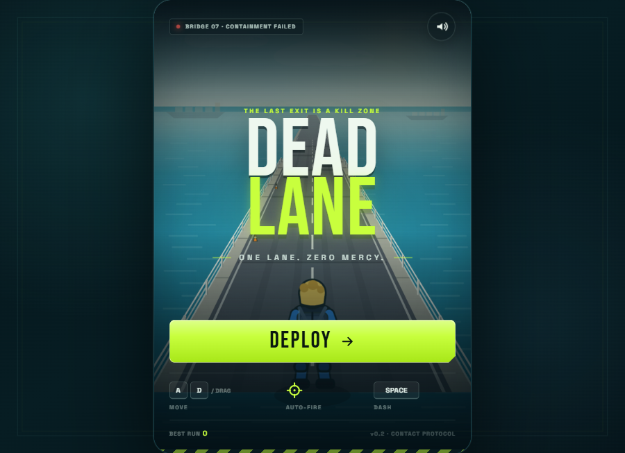
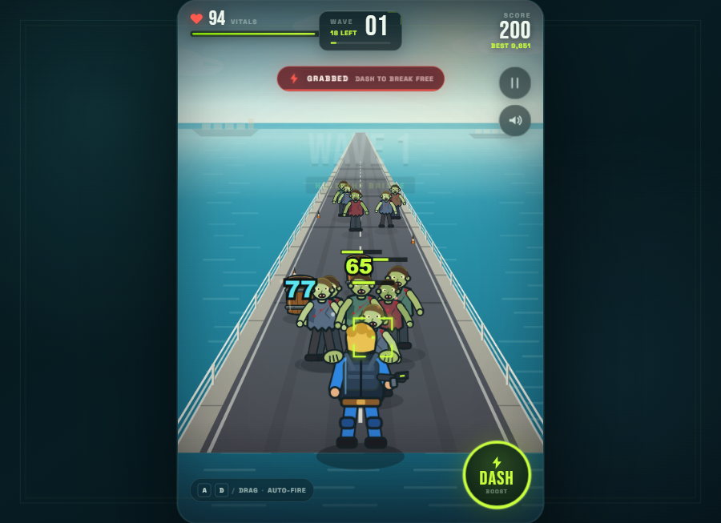

# DEADLANE

A mobile-first browser zombie horde shooter. Hold a bridge lane, auto-fire into a growing crowd, line up on supply caches, dash out of grabs, and chase a higher score every run.

> One lane. Zero mercy.




## Framework choice

**React 19 + TypeScript + Vite for the UI shell, with a purpose-built Canvas 2D game engine.**

Why this stack for this game:

- The game is a 2.5D lane shooter, not a 3D open world. A custom Canvas renderer gives full control over perspective, draw order, procedural sprites, and horde density without a 3D model/animation pipeline.
- The simulation is plain TypeScript and has no React dependency. React only renders screens, HUD, and overlays. This keeps the game loop out of component state and avoids the usual React game-loop spaghetti.
- Canvas 2D comfortably renders the current horde with pre-rendered procedural sprites. If the art direction later moves to real 3D, `Renderer` is the only layer that needs replacing; `GameWorld` and the UI contract stay intact.
- Vite keeps the dev/build loop tiny. The current production build is about **93 KB gzipped for JS + CSS**, plus ~89 KB of self-hosted font files.

If the project later needs large 3D scenes, character animation, and a content-heavy asset pipeline, the recommended upgrade path is **Three.js / React Three Fiber for rendering**, while keeping the fixed-step simulation and snapshot-based UI boundary. Do not rewrite the game logic into React components.

## Run it

```bash
npm install
npm run dev
```

Open `http://localhost:5173`.

Production check:

```bash
npm run typecheck
npm run build
npm run preview
```

## Controls

| Action | Desktop | Touch |
| --- | --- | --- |
| Move | `A` / `D` or arrow keys | Drag anywhere on the lane |
| Aim / fire | Automatic | Automatic |
| Dash | `Space` or dash button | Dash button |
| Pause | `P` / `Escape` | Pause button |
| Start / restart | `Enter` or button | Button |

Dash gives brief invulnerability. Keep a streak alive to raise the score multiplier. A wave clear patches up some health and pays a bonus.

Auto-fire normally prioritizes the closest zombie. If you line up with a supply cache, the cache can become the target instead. Caches explode for area damage and drop a color-coded reward: **lime = medkit**, **cyan = overdrive**, **gold = score**. When a zombie reaches you it grabs; dash to break free before your health drains. At 0 HP the player is swarmed, then the run ends.

## What is in the current build

- Start, pause, overrun, game-over, and restart flow
- Local best-score and sound-preference persistence
- Fixed-timestep simulation, independent of frame rate
- Keyboard and pointer/touch movement
- Auto-targeting with tracers, critical hits, hit flashes, and target reticle
- Dash with cooldown, afterimages, and invulnerability frames
- Combo multiplier and floating score feedback
- Endless escalating waves with close-range vanguard spawns
- Destructible supply caches with readable HP labels, color-coded rewards, blast damage, and score
- Contact grabs: zombies lunge, slow the player, and drain health; dash breaks grabs
- Overrun sequence and result screen when the player is reached at 0 HP
- Overdrive fire-rate buff with HUD timer
- Procedural player, zombie, and barrel sprites; bridge/ocean scene; particles; screen shake; hurt vignette; low-health warning
- Procedural WebAudio sound effects (no audio assets required)
- Responsive portrait, desktop, and landscape layouts

Deliberately **not** in this slice: lane-blocking barricades, tap/click focus targeting, 3-choice upgrade screens, zombie variants that interact with caches, bosses, vehicles, permanent meta progression, missions, cosmetics, analytics, and PWA/offline packaging. Those are sequenced in [docs/ROADMAP.md](docs/ROADMAP.md).

## Architecture

```text
src/
  game/
    GameEngine.ts       Loop, fixed timestep, snapshots, audio/input wiring
    GameWorld.ts        Pure simulation: player, zombies, caches, contact, waves, effects
    Renderer.ts         Canvas scene, perspective projection, sprites, barrel labels, FX
    SpriteBank.ts       Procedurally rendered sprite atlases
    InputController.ts  Keyboard + pointer input normalization
    AudioEngine.ts      Tiny WebAudio synthesizer
    config.ts           All balance and tuning constants
    types.ts            Shared simulation/UI contracts
    math.ts, storage.ts
  components/
    GameStage.tsx       React <-> engine bridge
    Hud.tsx             In-game HUD, grab warning, buff timer
    Overlays.tsx        Start / pause / overrun / game-over screens
    Icons.tsx
  styles.css
```

### Data flow

```text
keyboard / pointer
        │
        ▼
InputController ──► GameWorld (fixed 60 Hz) ──► Renderer (every RAF)
                         │
                         └── GameSnapshot (10 Hz) ──► React HUD / overlays
```

React never mutates the simulation. It only calls engine commands (`start`, `togglePause`, `requestDash`, `toggleMute`) and renders the latest snapshot. The game can be rendered and tested without React, and the HUD can be redesigned without touching the simulation.

### Tuning

Most feel changes live in `src/game/config.ts`:

- Player damage, fire rate, dash, crit chance, overdrive fire-rate multiplier
- Zombie count/HP/speed/spawn interval scaling
- Wave break length and heal amount
- Spawn depth, attack depth, grab duration/depth, and grab slow
- Cache HP, blast radius/damage, rewards, and alignment window

The vanguard spawn logic and cache placement are in `GameWorld.beginWave()`. The zombie-vs-cache aim-target scoring is in `GameWorld.findTarget()`. Contact and overrun timing live under `GAME.contact`.

## Design notes

- **The horde is the spectacle.** Close-range vanguard spawns were added specifically so waves do not become a shooting gallery at the horizon.
- **Auto-fire needs movement to stay interesting.** The player's job is lane positioning, dash timing, and streak preservation. Caches only enter the auto-fire target pool when the player is roughly in their lane, so lining up is the deliberate input.
- **Caches are a risk/reward target.** Shooting one spends time and diverts fire from the horde, but the blast and reward can flip a wave. Reward color is shown in the cache HP label so the choice is readable before committing.
- **Contact must be readable.** Zombies do not just chip health from a distance; they lunge, grab, and visibly cling to the player. The dash is both a repositioning tool and the escape button. At 0 HP the player is swarmed, then the run ends.
- **No asset dependency.** Sprites are drawn once into offscreen canvases; the renderer only scales and composites them. This keeps placeholder art consistent and fast.

## Quality checks used

- `npm run typecheck`
- `npm run build`
- Headless mobile (390×844), desktop, and landscape (844×390) visual passes
- Start, pause, resume, keyboard pause, dash, grab break, cache destruction, overdrive pickup, wave clear, best-score persistence, overrun, and game-over/restart flow exercised in-browser
